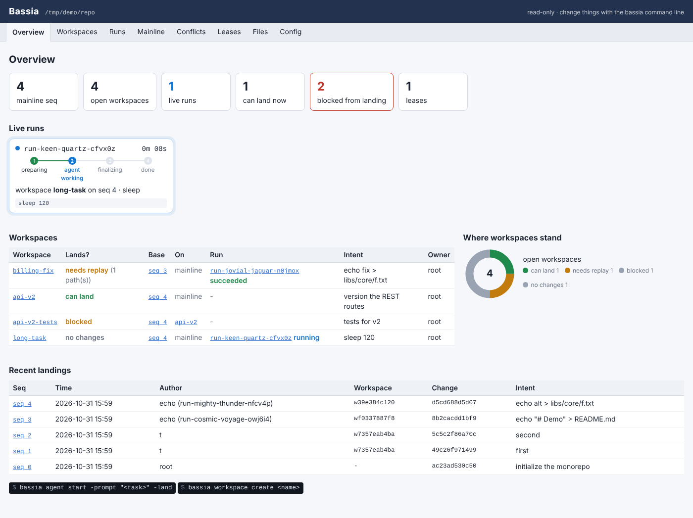
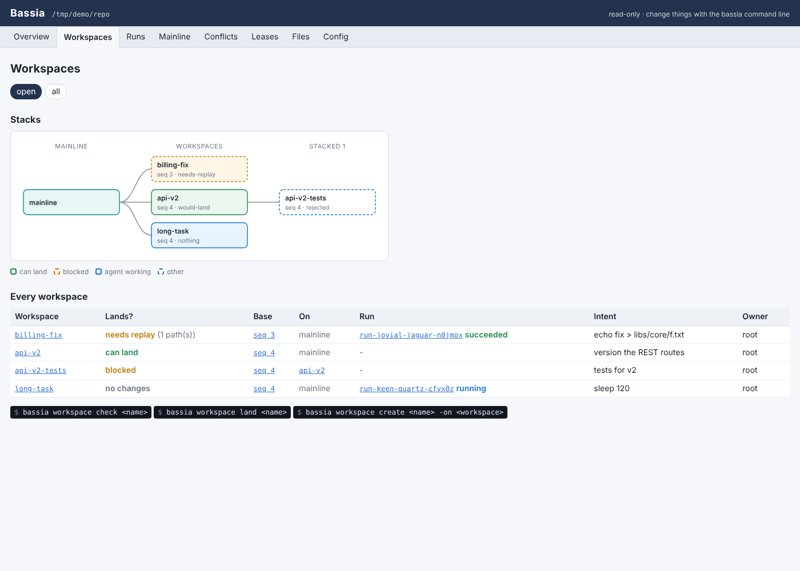
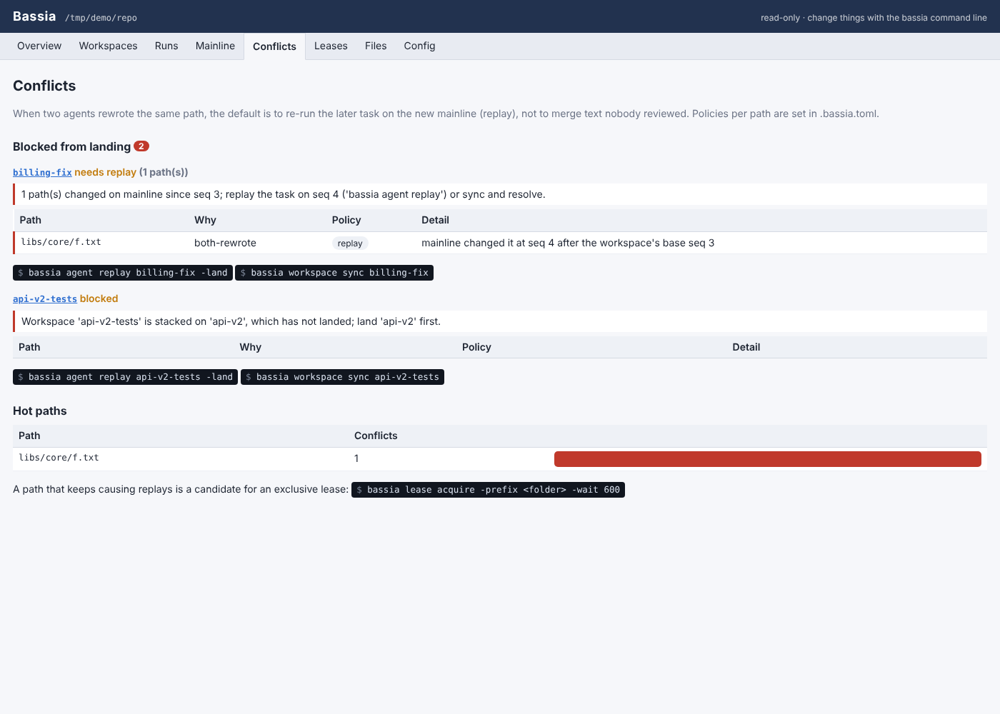
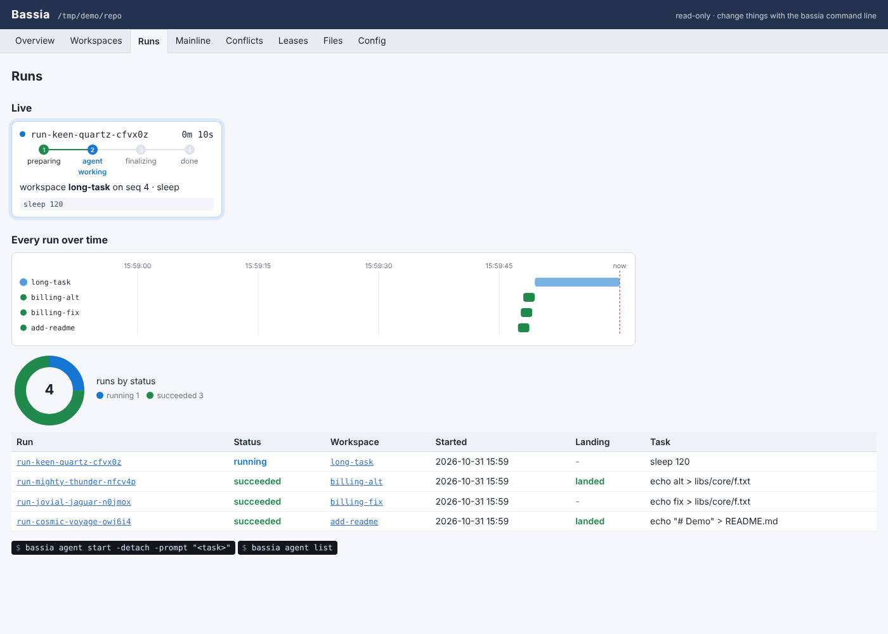

# Bassia

**A client-server monorepo for fleets of coding agents: a workspace per run, one trunk to land on.**

Bassia is version control built for agents that rewrite whole files and directories in parallel. There are no
branches, tags or commits to manage: every agentic run gets its own **workspace** over the monorepo, its work is
snapshotted implicitly, and you watch whether each workspace can **land** on the single trunk. When two agents rewrote
the same file, Bassia does not merge text nobody reviewed: it re-runs the later task on the new trunk.



- **[Workspaces instead of branches](#workspaces-instead-of-branches)**: one per run, stacked or cloned when work
  builds on work; commits are implicit.
- **[Landing is the only contention](#landing-is-the-only-contention)**: only the paths a workspace touched are
  compared with the trunk; disjoint work lands without any merge.
- **[Replay, not merge](#replay-not-merge)**: a conflict re-runs the task on the new trunk with the same change id;
  text, semantic and stored-conflict policies are there where you want them.
- **[Cheap rewrites, lazy reads](#cheap-rewrites-lazy-reads)**: content-defined chunks in cloud blob storage; status
  and listings come from hashes and metadata, file bytes only when something reads them.
- **[Client-server, testable on a laptop](#client-server-testable-on-a-laptop)**: the same core runs in a local
  monorepo and in `bassia-server`; a local-disk blob store stands in for S3.
- **[A dashboard you look at](#a-dashboard-you-look-at)** and **[a CLI made for agents](#a-cli-made-for-agents)**.
- **[Bring your git repositories](#bring-your-git-repositories)**: import several at once, export the trunk back.

The design behind it: [Design: Cloud-Backed Version Control for Agentic Development](https://claude.ai/artifact/V2nkDzNs8XAsx1E9PpgwM7).
The whole guide: [docs/reference.md](docs/reference.md).

## Workspaces instead of branches

```sh
bassia init -path ~/acme && cd ~/acme
bassia workspace create fix-login -intent "fix the login redirect"   # a folder holding the trunk's newest tree
$EDITOR workspaces/fix-login/src/auth/login.ts                        # any tool, any agent
bassia workspace status fix-login                                     # snapshotted on the way: no add, no commit
bassia workspace create fix-login-tests -on fix-login                 # stacked: starts from fix-login's work, lands after it
bassia workspace clone -from fix-login -name fix-login-alt            # the same work as a new change: try another way
```

On Windows, keep the monorepo on a [Dev Drive](https://learn.microsoft.com/en-us/windows/dev-drive/) and workspaces are
created by block cloning: each file's content is stored once and every workspace shares it copy-on-write, so a new
workspace over a large monorepo costs metadata, not bytes (`bassia devdrive status` tells whether a folder qualifies).

Every mutation is an operation in the workspace's own log, so `workspace undo` and `workspace restore -op <n>` recover
any earlier state, and an abandoned run is never lost. Workspaces never contend with each other, however many agents
snapshot at once.



## Landing is the only contention

```sh
bassia workspace check fix-login        # would-land, or why not: the paths and what their policy does
bassia workspace land fix-login         # the next seq on the trunk, keeping the change id
bassia mainline log                     # one linear history, numbered by seq
```

A landing compares only the paths the workspace touched with the trunk since the workspace's base: paths nobody else
changed are taken as they are, equal results are accepted, and the commit lands by compare-and-swap. Losing a race
costs only those paths again. Leases (`bassia lease acquire src/Billing`) hold a prefix for a run with fencing tokens,
so a stalled agent cannot overwrite its successor; `.bassia.toml` can require them where it matters.

## Replay, not merge

When two agents rewrote the same file, a textual merge yields plausible but unreviewed code. The default policy is
**replay**: the landing is refused with the paths and the new trunk, and

```sh
bassia agent replay add-request-logging -land
```

runs the same task (prompt, agent, model, recorded with the change) again on the new trunk, in a new workspace that
keeps the change id. Per path glob, `.bassia.toml` can choose `textmerge` (line-based, while both sides stay similar),
`semantic` (weave's language-aware merge, landed only after your validation command passes) or `conflict` (stored
with markers in the workspace to resolve by hand).



## Cheap rewrites, lazy reads

Every object is immutable and content-addressed (BLAKE3 over canonical CBOR). Files are cut into content-defined
chunks, so a rewrite that keeps part of a file uploads only the new part, after asking which chunks the server already
has. Comparing two trees skips every subtree with an equal id, tree entries carry size and kind, and a workspace
re-hashes only files whose size or time changed - so status, listings and diff statistics never read file content.
Diffs are derived, never stored; a file that shares little with its old version is reviewed as rewritten, side by
side, instead of as a wall of hunks.

## Client-server, testable on a laptop

```sh
bassia-server -data /srv/bassia -url http://0.0.0.0:8080 -token <token>          # blobs on local disk
bassia-server -data /srv/bassia -storage s3 -bucket acme-bassia -token <token>   # blobs on S3
bassia clone -from http://bassia.example.com:8080 -path ~/acme -token <token>
```

The version core reaches storage only through four small interfaces - objects, heads, the path index and leases - so
the same core runs in a local monorepo (`bassia init`: a local-disk blob container and SQLite) and in `bassia-server`
(the same stores, or S3). A clone talks to the server and caches every object it reads. Large chunks travel between
clients and blob storage on signed URLs; the server never proxies file bytes. Every test runs without a cloud account.

## A dashboard you look at

`bassia web` (and the server's front page) shows the live runs, every workspace with whether it can land right now,
the stacks, the trunk's landings with their diffs, what blocks landings and which paths keep colliding, leases, the
files at any seq, and the policy. It is read-only: every page shows the commands that act on what it shows.



## A CLI made for agents

Every command answers in TOML (`-human` for Markdown), with exit codes 0, 1 and 2. `bassia help -all` teaches an agent
the whole CLI in one call. Agentic runs are built in:

```sh
bassia agent start -prompt "paginate the list endpoint" -land -detach   # its own workspace, landed when it succeeds
bassia agent list                                                       # live, succeeded, failed, lost
bassia agent logs paginate-the-list-endpoint-4f2a91 -tail 20
```

## Bring your git repositories

```sh
bassia import -git https://github.com/acme/api.git,https://github.com/acme/web.git -history
bassia export -git ../acme-mirror                                       # the trunk as git history, incrementally
```

Each repository goes into its own top-level folder, as a baseline or with its history interleaved by commit time; each
imported commit lands like any agent's work. The export writes one git commit per landing with a `Change-Id:` trailer.

## Install, build, test

Ask Claude Code to `/bassia-install` in a clone of this repository, or build it yourself with the .NET 10 SDK:

```sh
dotnet build
dotnet test
dotnet run --project Bassia -- help
```

See [docs/reference.md](docs/reference.md) for installing side by side, the server, the policy file, every command,
the architecture and the tests.
